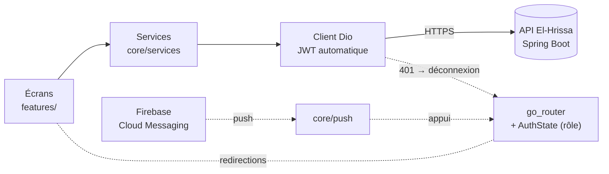

<div align="center">

# 🌶️ Elahrisa

**Rencontrez des gens près de chez vous et sortez ensemble.**
L'application tunisienne de rencontres et d'événements, en Flutter pour Android et le web.


-supportés-lightgrey)


[Fonctionnalités](#-fonctionnalités) · [Démarrage rapide](#-démarrage-rapide) · [Tests](#-tests) · [Build et diffusion](#-build-et-diffusion) · [Notifications push](#-notifications-push) · [Roadmap](#-roadmap)

</div>

---

## ✨ Fonctionnalités

| | |
|---|---|
| 🃏 **Swipe** | Profils autour de vous (GPS ou Tunis par défaut), filtres de distance et d'âge, animation de match, images redimensionnées et préchargées |
| 🤝 **Rencontres** | Recherche de personnes, demandes de connaissance, acceptation ou refus |
| 💬 **Chat** | Conversations avec dernier message (chargé en un seul appel), rafraîchissement automatique, signalement, blocage, suppression de match |
| 🎉 **Événements sociaux** | Liste et filtres, pastille « N pour vous » (centres d'intérêt communs), inscription avec **liste d'attente** quand c'est complet, participants (sans soi-même ni personnes bloquées), « Mes événements », « Qui avez-vous croisé ? » après l'événement |
| 🧑‍💼 **Organisateurs** | Choix **Visiteur / Organisateur** à l'inscription, formulaire de demande examiné par l'équipe, création et modification de ses événements, page publique de l'organisateur |
| 🛡️ **Modération** | Réservée aux modérateurs : demandes d'organisateur, vérifications de selfie, signalements, statistiques, utilisateurs |
| 👤 **Profil** | Bio, intérêts, préférence de rencontre, galerie, position, badge « profil vérifié » par selfie |
| 🔑 **Compte** | Connexion par email ou Google, **« Se souvenir de moi »** (email partout ; mot de passe seulement sur mobile, dans le stockage chiffré d'Android, jamais sur le web), mot de passe oublié, suppression définitive du compte |
| 🔔 **Notifications** | Dans l'app avec compteur, et **en push sur Android** (même app fermée) ; un appui ouvre le bon écran |
| 🌐 **Web** | PWA installable, écran de chargement, mise en page centrée sur grand écran (`WebFrame`) |

## 🏗️ Architecture



```
lib/
├── main.dart          routes, garde d'authentification, cadre web
├── core/
│   ├── api/           client Dio, endpoints, traduction des erreurs
│   ├── auth/          état de session et rôle, « se souvenir de moi »
│   ├── models/        modèles alignés sur les DTO du backend
│   ├── services/      un service par domaine (auth, profil, swipe, chat, événements, organisateurs, modération…)
│   ├── push/          jeton Firebase, permission, notifications au premier plan
│   ├── notifications/ routage d'une notification vers son écran
│   └── theme/         couleurs, typographies, thème
├── features/          auth, home, swipe, people, chat, events, organizer, moderation, profile, notifications, welcome, legal
└── shared/            widgets (photos réseau, cadre web) et utilitaires (URL d'images)
android/               projet Android (signature de release, Firebase, icône, canal de notifications)
web/                   index.html (écran de chargement, aperçu de partage), manifest PWA
```

### Rôles dans l'app

| Rôle | Ce qui apparaît |
|---|---|
| Visiteur | Swipe, personnes, messages, événements, profil. Peut demander à devenir organisateur. |
| Organisateur | En plus : créer et modifier ses événements, « Mes événements ». |
| Modérateur | En plus : espace de modération (organisateurs, vérifications, signalements, statistiques). |

Les droits sont **toujours revérifiés par le serveur** : masquer un bouton n'est qu'un confort d'affichage.

## 🚀 Démarrage rapide

**Prérequis :** [Flutter](https://docs.flutter.dev/get-started/install) 3.x et le [backend](https://github.com/Aziz216-ui/El-Hrissa) (port 8086), ou l'API en ligne.

```bash
flutter pub get
flutter run -d chrome --dart-define=API_BASE_URL=http://localhost:8086
```

### Adresse de l'API

| Cas | URL utilisée |
|---|---|
| `--dart-define=API_BASE_URL=…` fourni | celle-ci, toujours |
| Build **release** sans option | l'API de production (`https://el-hrissa.onrender.com`) |
| Debug : web, simulateur iOS, desktop | `http://localhost:8086` |
| Debug : émulateur Android | `http://10.0.2.2:8086` |
| Debug : 📱 téléphone réel | à fournir : `--dart-define=API_BASE_URL=http://<IP-de-votre-PC>:8086` (même Wi-Fi) |

Connexion Google : `--dart-define=GOOGLE_CLIENT_ID=<identifiant OAuth web>` (sinon le bouton signale que Google n'est pas configuré).

> En production, utilisez une URL **HTTPS**. L'API gratuite sur Render s'endort sans trafic : la première requête peut prendre une trentaine de secondes.

## 🧪 Tests

```bash
flutter analyze
flutter test                                   # unitaires et widgets (45 tests)
flutter test test/api_contract_test.dart \
  --dart-define=API_BASE_URL=http://localhost:8086   # contrat avec le vrai backend
```

Les tests couvrent la logique des événements (capacité, liste d'attente, « pour vous »), les demandes d'organisateur, les choix de rôle à l'inscription, la recherche de personnes, les URL d'images et le routage des notifications.

Le **test de contrat** déroule un parcours complet (inscription, profil, photo, swipe, match, chat, notifications, événements, blocage) avec les vrais services Flutter. Pour que le backend local accepte l'inscription d'un organisateur, lancez-le avec `ALLOW_ORGANIZER_SIGNUP=true`.

> ⚠️ Il crée des comptes de test dans la base visée : ne le lancez jamais contre la production. Sans `API_BASE_URL` ou sans backend joignable, il est ignoré.

## 📦 Build et diffusion

### Web

```bash
flutter build web --release --dart-define=API_BASE_URL=https://votre-api.example.com
```

À chaque push sur `main`, GitHub Actions (`.github/workflows/web.yml`) analyse, teste, construit la version web et la publie sur **Netlify** (secrets `NETLIFY_AUTH_TOKEN` et `NETLIFY_SITE_ID`). Les routes sont redirigées vers `index.html`.

### Android (APK)

```bash
flutter build apk --release
```

Le résultat est dans `build/app/outputs/flutter-apk/app-release.apk`. Pour une nouvelle version, augmentez `version:` dans `pubspec.yaml` (par exemple `1.0.7+8` : le nombre après `+` doit toujours croître).

**Signature.** Toutes les mises à jour doivent être signées avec **la même clé**, sinon Android refuse de les installer par-dessus. Créez `android/key.properties` (jamais commité) :

```properties
storeFile=elhrissa-release.jks
storePassword=...
keyAlias=...
keyPassword=...
```

Gardez le fichier `.jks` et ces mots de passe dans une **sauvegarde hors du dépôt** : sans eux, plus aucune mise à jour possible. Sans `key.properties` (CI, autre machine), le build retombe sur la clé de débogage.

**Diffusion aux testeurs.** L'APK est distribué avec **Firebase App Distribution** (groupe `beta`) : les testeurs reçoivent un email et installent les nouvelles versions depuis l'app « App Tester ».

## 🔔 Notifications push

Android uniquement (le web et les autres plateformes ignorent le push sans erreur).

- `android/app/google-services.json` (configuration publique, non secrète) est lu à la compilation. Sans lui, l'app compile quand même, simplement sans push.
- Après la connexion, l'app demande l'autorisation (Android 13 et plus), envoie son jeton à `POST /api/devices`, et le retire à la déconnexion.
- Application ouverte : un bandeau avec « Voir ». Fermée : notification système sur le canal `elahrisa_default`.
- Un appui ouvre l'écran lié au type de notification (messagerie, événements, « Mes événements », profil, modération).
- Côté serveur, il faut `FCM_PROJECT_ID` et `FCM_CREDENTIALS_BASE64` : voir le README du [backend](https://github.com/Aziz216-ui/El-Hrissa).

> 🔒 Ne commitez jamais `android/key.properties`, le fichier `.jks` ni un fichier `*firebase-adminsdk*.json` (clé privée du serveur).

## 🗺️ Roadmap

- [x] Connexion à l'API réelle, sans données fictives
- [x] Swipe, matchs, chat, événements, notifications, profil complet
- [x] Blocage, signalement, vérification par selfie
- [x] Mot de passe oublié, suppression de compte, « se souvenir de moi »
- [x] Projet Android, icône, signature de release, APK distribué aux testeurs
- [x] Version web (PWA) publiée automatiquement
- [x] Événements sociaux : liste d'attente, « Mes événements », « Qui avez-vous croisé ? »
- [x] Visiteur / organisateur à l'inscription, espace de modération
- [x] Notifications push Android
- [ ] Bêta fermée : test à deux téléphones et retours des testeurs
- [ ] Recommandations d'événements (reportées) et discussions de groupe
- [ ] Chat en temps réel (aujourd'hui, rafraîchissement toutes les 4 s) ; iOS et stores

## 🔧 Backend

L'API (Spring Boot, PostgreSQL/PostGIS) est dans le dépôt **[El-Hrissa](https://github.com/Aziz216-ui/El-Hrissa)**, avec sa documentation Swagger.

---

<div align="center">Fait avec ❤️ et 🌶️ en Tunisie</div>
