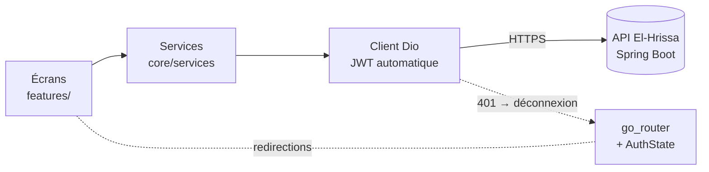

<div align="center">

# 🌶️ Elahrisa

**Rencontrez des gens près de chez vous et sortez ensemble.**
L'application tunisienne de rencontres et d'événements, en Flutter pour mobile et web.


[Fonctionnalités](#-fonctionnalités) · [Démarrage rapide](#-démarrage-rapide) · [Tests](#-tests) · [Build](#-build) · [Roadmap](#-roadmap)

</div>

---

## ✨ Fonctionnalités

| | |
|---|---|
| 🃏 **Swipe** | Profils autour de vous (GPS ou Tunis par défaut), filtres de distance et d'âge, animation de match |
| 💬 **Chat** | Conversations avec dernier message, rafraîchissement automatique, signalement, blocage, suppression de match |
| 🎉 **Événements** | Liste, détail et participants, inscription en un tap, découverte des autres participants |
| 👤 **Profil** | Bio, intérêts, préférence de rencontre, galerie de photos, position, badge « profil vérifié » par selfie |
| 🔑 **Compte** | Mot de passe oublié par email, état de vérification de l'email, suppression définitive du compte (avec confirmation) |
| 🔔 **Notifications** | Nouveaux matchs et messages avec compteur de non lus |
| 🛡️ **Sécurité** | Garde d'authentification, déconnexion automatique à l'expiration de session, liste des utilisateurs bloqués |
| 🧑‍💼 **Organisateurs** | Création et suppression d'événements depuis l'app |

## 🏗️ Architecture



```
lib/
├── main.dart          routes et garde d'authentification
├── core/
│   ├── api/           client Dio, endpoints, traduction des erreurs
│   ├── auth/          état de session
│   ├── models/        modèles alignés sur les DTO du backend
│   ├── services/      un service par domaine (auth, profil, swipe, chat, événements…)
│   └── theme/         couleurs, typographies, thème
├── features/          écrans : auth, home, swipe, chat, events, profile, notifications
└── shared/            widgets et utilitaires communs
```

## 🚀 Démarrage rapide

**Prérequis :** [Flutter](https://docs.flutter.dev/get-started/install) 3.x et le [backend](https://github.com/Aziz216-ui/El-Hrissa) démarré (port 8086).

```bash
flutter pub get
flutter run -d chrome --dart-define=API_BASE_URL=http://localhost:8086
```

### Adresse de l'API selon l'appareil

L'URL se règle avec `--dart-define=API_BASE_URL=…`. Sans cette option :

| Appareil | URL utilisée |
|---|---|
| Web, simulateur iOS, desktop | `http://localhost:8086` |
| Émulateur Android | `http://10.0.2.2:8086` |
| 📱 **Téléphone réel** | à fournir : `--dart-define=API_BASE_URL=http://<IP-de-votre-PC>:8086` (même Wi-Fi) |

> En production, utilisez une URL **HTTPS**.

## 🧪 Tests

```bash
flutter analyze
flutter test                                   # démarrage : redirection vers la connexion
flutter test test/api_contract_test.dart \
  --dart-define=API_BASE_URL=http://localhost:8086   # contrat avec le vrai backend
```

Le **test de contrat** déroule un parcours complet (inscription, profil, photo, swipe, match, chat, notifications, événements, blocage) avec les vrais services Flutter, ce qui garantit que les modèles lisent bien les réponses de l'API.

> ⚠️ Il crée des comptes de test dans la base visée : ne le lancez jamais contre une base de production. Sans `API_BASE_URL` ou sans backend joignable, il est ignoré.

## 📦 Build

```bash
flutter build web --release --dart-define=API_BASE_URL=https://votre-api.example.com
```

Les dossiers `android/` et `ios/` ne sont pas encore dans le dépôt. Pour compiler une app mobile :

```bash
flutter create --platforms=android,ios .
```

Déclarez ensuite les permissions **localisation** et **caméra** (`AndroidManifest.xml`, `Info.plist`) : elles servent au GPS, à la photo de profil et au selfie de vérification.

## 🗺️ Roadmap

- [x] Connexion à l'API réelle, sans données fictives
- [x] Swipe, matchs, chat, événements, notifications, profil complet
- [x] Blocage, signalement, vérification par selfie
- [ ] Génération des projets Android et iOS, puis tests sur appareils
- [x] Mot de passe oublié, suppression de compte, bandeau « email non vérifié »
- [ ] Notifications push et chat en temps réel (aujourd'hui, rafraîchissement toutes les 4 s)
- [ ] Espace de modération pour les organisateurs (signalements, validation des selfies)
- [ ] Publication : APK, version web (PWA), stores

## 🔧 Backend

L'API (Spring Boot, PostgreSQL/PostGIS) est dans le dépôt **[El-Hrissa](https://github.com/Aziz216-ui/El-Hrissa)**, avec sa documentation Swagger.

---

<div align="center">Fait avec ❤️ et 🌶️ en Tunisie</div>
